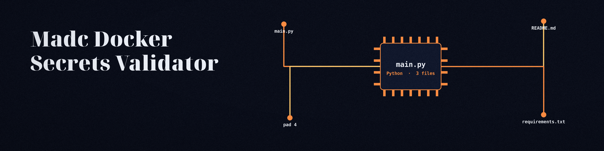

# madc-Docker-Secrets-Validator
A command-line tool that scans Dockerfiles and docker-compose.yml files for potential exposure of secrets. It identifies hardcoded passwords, API keys, and other sensitive information by searching for specific patterns and variable usage.  Supports custom regex rules defined by the user. - Focused on Defines security policies as YAML/JSON and programmatically validates system configurations (files, API responses) against these policies. Enables Infrastructure as Code (IaC) security auditing and automated configuration hardening. Uses schemas for policy validation and CLI interface for ease of use.

When no policy file is supplied with `-p`, the tool uses a built in Docker policy: rules for Dockerfile ENV and ARG lines that name a secret, compose environment entries that name a secret, AWS access key IDs, and private key headers. A policy file supplied with `-p` replaces that built in policy. Matched values are masked in the log. If a file cannot be scanned, the run ends by stating how many files could not be scanned and exits 1 instead of reporting completion.

## Install
`git clone https://github.com/ShadowStrikeHQ/madc-docker-secrets-validator`

## Usage
`./madc-docker-secrets-validator [params]`

## Parameters
- `-h`: Show help message and exit

## License
Copyright (c) ShadowStrikeHQ
